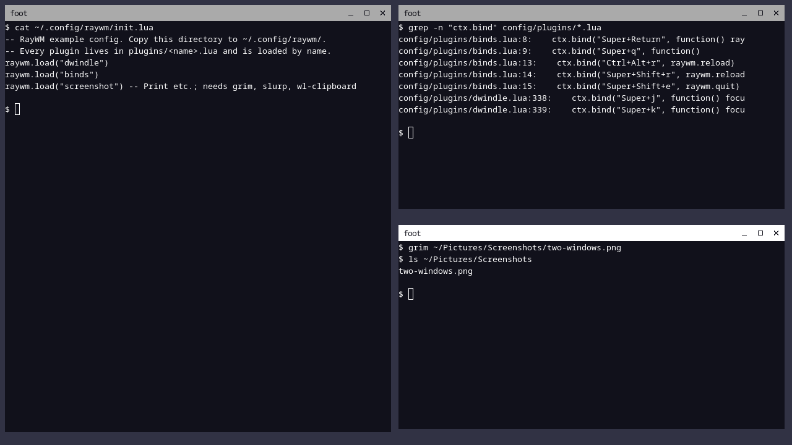
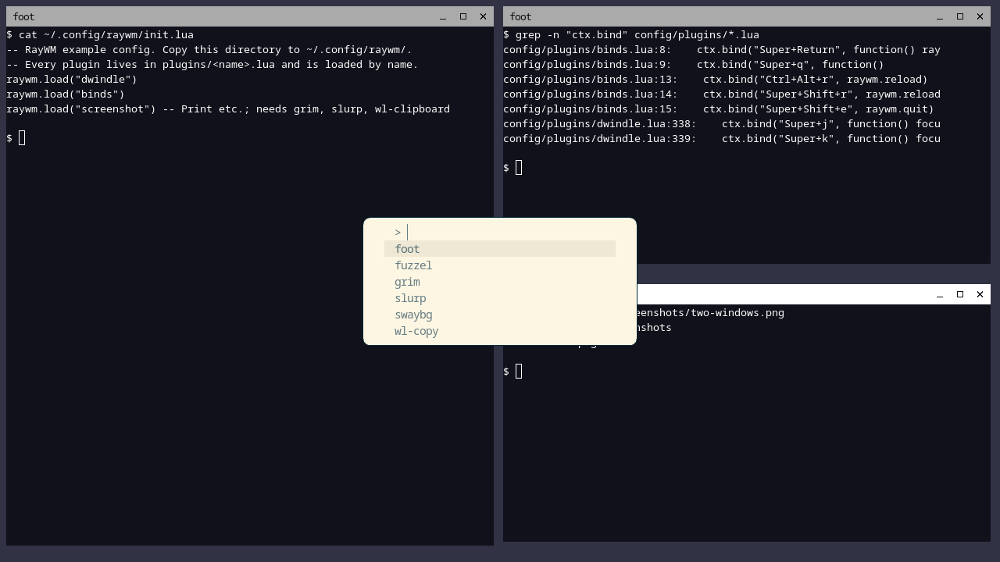
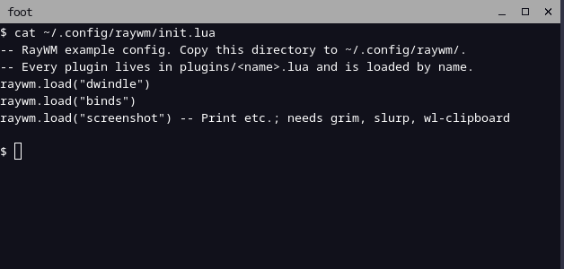

# RayWM

[](https://github.com/Rreeqqwel/RayWM/actions/workflows/ci.yml?query=branch%3Amaster)
[](https://github.com/Rreeqqwel/RayWM/actions/workflows/release.yml)
[](https://github.com/Rreeqqwel/RayWM/releases)

A lightweight Wayland compositor written in Zig on top of wlroots, with
its window-management policy written in Lua.

**Philosophy:** a minimal core and maximum extensibility, with
correctness ahead of artificial code reduction.
- The native core does what must be correct and fast: Wayland protocols,
  input, outputs, rendering and resource lifetimes.
- Everything that is policy is a Lua plugin: tiling, key bindings and
  window rules.
- Basic settings (focus, gaps, borders, drag modifier) live in one small,
  validated file, `raywm.conf`.

> **Status: v0.2.2 (Configuration & Update System), Beta, experimental.**
> v0.2.2 adds the central `raywm.conf` and the `raywm-update` manager with
> persistent Beta/Stable channels; see [CHANGELOG.md](CHANGELOG.md).
> Earlier implementation and validation are recorded in [the development
> ledger](docs/DEVELOPMENT.md) and [candidate acceptance](docs/RELEASE-STATUS.md).
> Headless tests do not establish physical hardware compatibility.

## Features

- **Wayland compositor on wlroots 0.20.**
  - xdg-shell windows and popups, with correct configure/ack handling.
  - Keyboard and pointer, click-to-focus, and the Wayland **implicit
    pointer grab**: a drag keeps going to the window where it started
    (also across outputs) until the last button is released.
  - Key bindings that work in every layout of the keymap (e.g. `us,ru`).
  - Multiple outputs with hotplug.
  - VT switching on a real session.
- **Layer-shell** (wlr-layer-shell v5) for external panels, docks,
  launchers and wallpapers: exclusive zones, keyboard interactivity,
  popups.
- **Native window state:** floating, fullscreen, maximize, minimize and
  urgency, with configure/ack handling, dialog stacking and focus rules.
- **Workspaces:** one shown per output, native visibility/focus and hotplug
  recovery; Lua controls naming, switching, assignment and tiling.
- **Window rules:** application/title/parent/output/workspace matching,
  floating dialog defaults, geometry, opacity and decoration choices.
- **Session lock and idle:** ext-session-lock with abandoned-lock handling,
  idle notifications/inhibition, and optional swaylock/swayidle autostart.
- **Output/input configuration:** mode, scale, transform, position,
  adaptive sync, DPMS and gamma; keyboard layouts/repeat and libinput
  settings by device or type. Hardware-dependent settings need physical
  testing.
- **Wayland protocols:** data control and primary selection, scaling,
  viewporter/single-pixel buffers, presentation, cursor shape,
  decorations, activation and security-context filtering. See
  [SECURITY.md](SECURITY.md) for the unrestricted-client trust boundary.
- **Pointer capture and desktop protocols:** lock/confinement and relative
  motion, shortcut inhibitors with an emergency release, foreign-toplevel
  management/listing and ext-workspace activation/state.
- **Xwayland:** lazy process lifecycle, X11 windows through the common
  view/workspace model, override-redirect menus and clipboard bridging.
- **Data and IME:** native cross-client drag-and-drop, text-input-v3,
  input-method-v2, candidate popups and virtual keyboard reinjection.
- **Optional native effects:** frame-synchronized position/opacity tweens,
  close/workspace snapshots and plugin-owned rectangles; no Lua per frame.
  See [EFFECTS.md](docs/EFFECTS.md).
- **External IPC v1:** bounded local JSON queries, events and focus/workspace
  actions, with `raywmctl`; see [IPC.md](docs/IPC.md).
- **Gaming path** (0.2.1): direct scanout through wlroots when eligible,
  explicit sync when the GPU stack supports it, opt-in tearing for
  fullscreen games, and `raywmctl perf` diagnostics; see
  [GAMING.md](docs/GAMING.md).
- **Interactive move/resize** for floating windows (Super + drag, or the
  client's own title bar; the modifier is configurable).
- **`raywm.conf`** (v0.2.2): one validated INI-like file for the basic
  settings, layered (defaults, system, user), with line-numbered errors,
  `raywm -t`, and reload that never applies a broken file. Optional
  focus-follows-mouse and inactive borders.
- **`raywm-update`** (v0.2.2): checks GitHub Releases for your persistent
  Beta or Stable subscription, verifies SHA256, builds Betas into a pacman
  package as your user and installs through `pacman -U`.
- **Lua 5.4 plugin system (API v1).**
  - One clear loading contract.
  - Per-plugin ownership of handlers, bindings, timers and visual resources.
  - A failing plugin is unloaded without affecting the others.
  - Memory and instruction limits.
  - Integer ids instead of pointers.
  - Live reload.
- **Dwindle tiling** (Hyprland-style), written entirely in Lua.
  - Per-workspace binary trees, focus-based splits, inner/outer gaps,
    split resizing, swapping and split-direction toggling.
  - Respects panels, and keeps its layout across reloads.
  - Tiled windows are protected from accidental dragging through
    `ctx.manage`.
- **Keyboard focus navigation** (`config/plugins/focus.lua`, Lua):
  directional focus (Super+H/J/K/L) by window geometry across outputs,
  a focus cycle (Super+Tab), an optional pointer warp, and borders
  around the focused (and optionally the other) windows.
- **Screenshots** (`config/plugins/screenshot.lua`, a plain Lua plugin):
  full screen, interactive region, clipboard copy, PNG files with unique
  names, notifications. The capturing is done by grim, slurp and
  wl-clipboard; the core only provides the standard wlr-screencopy and
  xdg-output protocols. See [Screenshots](#screenshots).
- **Robust defaults.** Fallback bindings when the configuration is
  missing or broken, and clean shutdown.

## Supported platforms

- Linux, **x86_64**. The release binary is built on Arch Linux and
  dynamically linked.
- Needs **wlroots 0.20.x**, **Lua 5.4**, wayland-server, xkbcommon and
  **glibc ≥ 2.36** at runtime, with the sonames listed in
  [docs/INSTALL.md](docs/INSTALL.md).
- On other distributions, build from source. Only Arch Linux was
  tested.

## Build

```sh
# Arch Linux build dependencies
sudo pacman -S --needed git wlroots0.20 wayland wayland-protocols libxkbcommon pixman lua54 pkgconf
# Zig 0.16.0 exactly (see docs/INSTALL.md for the checksum-verified download)
zig build -Doptimize=ReleaseSafe      # -> zig-out/bin/raywm
```

| Component | Version |
|---|---|
| Zig | 0.16.0 |
| wlroots (system) | 0.20.x |
| zig-wlroots / zig-wayland / zig-xkbcommon / zig-pixman | 0.20.1 / 0.6.0 / 0.3.0 / 0.3.0 (hashes in `build.zig.zon`) |
| Lua (system) | 5.4 |

## Install

Releases come in two channels ([docs/RELEASE-WORKFLOW.md](docs/RELEASE-WORKFLOW.md)):

- **Stable** (`vX.Y.Z-stable`): an Arch Linux package with a ready binary.
  ```sh
  sha256sum -c raywm-X.Y.Z-1-x86_64.pkg.tar.zst.sha256
  sudo pacman -U raywm-X.Y.Z-1-x86_64.pkg.tar.zst
  cp -r /usr/share/raywm/config ~/.config/raywm   # only if you have no configuration yet
  ```
- **Beta** (`vX.Y.Z-beta[.N]`, GitHub Pre-release): a source archive,
  built into a pacman package as your user (needs `base-devel`,
  `wayland-protocols`, `pkgconf`):
  ```sh
  sha256sum -c raywm-v0.2.2-beta.tar.gz.sha256
  tar -xzf raywm-v0.2.2-beta.tar.gz
  raywm-v0.2.2-beta/scripts/arch-package.sh v0.2.2-beta raywm-v0.2.2-beta.tar.gz pkg
  sudo pacman -U pkg/raywm-0.2.2beta-1-x86_64.pkg.tar.zst
  ```
  Other distributions: [docs/INSTALL.md](docs/INSTALL.md#install-a-beta-release-source-built-into-a-pacman-package).

The first install subscribes you to the channel you installed. After
that, updates come through **`raywm-update`**:

```sh
raywm-update --check                    # newest update for your channel (installs nothing)
raywm-update --install                  # download, verify (SHA256), build if Beta, pacman -U
raywm-update --channel                  # show the subscription
sudo raywm-update --set-channel stable  # Stable releases only (beta: Beta and Stable)
```

The channel is your setting, not a property of the installed version:
installing a Stable release from the beta channel keeps you on beta, and
package upgrades never reset it. Details, guarantees and limits of the
checksum verification: [docs/INSTALL.md](docs/INSTALL.md#updates-raywm-update).

Releases up to v0.2.1 (before the channels) ship a binary archive with
`install.sh`:

```sh
tar -xzf raywm-v0.2.1-linux-x86_64.tar.gz && cd raywm-v0.2.1
./install.sh        # ~/.local/bin/raywm; config copied only if ~/.config/raywm does not exist
```

`install.sh` needs no root. It does not replace your current window
manager, and it never overwrites an existing binary (without `--force`)
or configuration. Full guide: [docs/INSTALL.md](docs/INSTALL.md).

### Upgrading from v0.1.1

Replace the binary (`./install.sh --force`, which keeps a backup). Your
`~/.config/raywm` is not touched and keeps working as before. To get the
new focus keys and the focus border, copy `config/plugins/focus.lua` and
`config/plugins/dwindle.lua` into `~/.config/raywm/plugins/`, add
`raywm.load("focus")` to `init.lua`, and press Ctrl+Alt+R. Step by step:
[docs/CONFIGURATION.md](docs/CONFIGURATION.md#upgrading-from-v011).

## Run

**Nested**, inside an existing Wayland session (the safest way to try it):

```sh
raywm -s foot
```

**From a TTY:** log in on a free VT (e.g. Ctrl+Alt+F3) and run
`raywm -s foot`. Seat access comes from systemd-logind or seatd. Quit
with Super+Shift+E. TTY use is not covered by the automated tests.

Options:
- `-c FILE`: use another config file;
- `-s CMD`: startup command, e.g. `-s 'waybar & foot'`;
- `-d`: verbose log: wlroots, plus each key press with Super, Ctrl or
  Alt and the binding it matched (plain typing is never logged);
- `-h`: help.

The keyboard layout comes from `XKB_DEFAULT_LAYOUT`, `XKB_DEFAULT_OPTIONS`
and the other xkb variables, e.g.
`XKB_DEFAULT_LAYOUT=us,ru XKB_DEFAULT_OPTIONS=grp:alt_shift_toggle`.

## Default key bindings

With the example configuration (`config/`):

| Keys | Action |
|---|---|
| Super+Return | terminal (`$TERMINAL`, default `foot`) |
| Super+Q | close the focused window |
| Super+Shift+Space | toggle floating |
| Super+F / Super+M | toggle fullscreen / maximize |
| Super+N / Super+Shift+N | minimize / restore the latest minimized visible-workspace window |
| Super+1..9 / Super+Shift+1..9 | switch workspace / move focused window |
| Super+Ctrl+H/J/K/L | resize the neighboring dwindle split |
| Super+Shift+H/J/K/L | swap with the neighboring tile |
| Super+T | toggle split direction |
| Ctrl+Alt+Escape | release pointer capture and shortcut inhibition |
| Super+H / J / K / L | focus the window to the left / below / above / right |
| Super+Tab / Super+Shift+Tab | focus the next / previous window |
| Ctrl+Alt+R (or Super+Shift+R) | reload the configuration |
| Super+Shift+E | quit |
| Print / Shift+Print | save a screenshot of all outputs / of a selected region |
| Ctrl+Print / Ctrl+Shift+Print | copy a screenshot / a region to the clipboard |
| Ctrl+Alt+P | save a screenshot (for nested sessions, where the outer compositor may keep Print) |
| Super + left / right drag | move / resize a floating window |
| Ctrl+Alt+F1..F12 | switch VT (TTY sessions) |

Without a configuration, or when no plugin binds keys, the core keeps
three **fallback bindings**: Super+Return, Super+Shift+R and
Super+Shift+E.

## Dwindle tiling

`config/plugins/dwindle.lua` gives each workspace (or output without
workspaces) a binary tree:
- a new window splits the focused window's area along its longer side
  and takes focus, so windows spiral inwards;
- closing a window gives its area to its sibling;
- the tree is edited in place, and only geometry is recomputed when
  windows, outputs or panels change;
- gaps default to 8 px;
- the tree shape survives `raywm.reload()`.

Details and options: [docs/CONFIGURATION.md](docs/CONFIGURATION.md).

## Screenshots

These are real screenshots of RayWM, taken with grim through RayWM's
wlr-screencopy support in an isolated headless session
(`scripts/gallery.sh` regenerates them). The clients are foot and
fuzzel; the layout is the shipped dwindle plugin.

| Dwindle tiling (three foot windows) | Layer-shell launcher (fuzzel) over the tiles |
|---|---|
|  |  |

A region capture (`grim -g`, as Shift+Print saves it):



### Taking screenshots

The example configuration loads `screenshot.lua`. It needs these
programs, which are **not** needed by RayWM itself:

| Program | Arch Linux package | Used for | If missing |
|---|---|---|---|
| `grim` | `grim` | capturing | every action fails with a logged error and, if possible, a notification |
| `slurp` | `slurp` | selecting a region | region actions fail the same way |
| `wl-copy` | `wl-clipboard` | the clipboard | copy actions fail the same way |
| `notify-send` | `libnotify` | notifications | silently skipped |

Files go to `$XDG_PICTURES_DIR/Screenshots` (when that variable holds an
absolute path) or `~/Pictures/Screenshots`, named
`screenshot-YYYY-MM-DD_HH-MM-SS.png`; an existing file is never
overwritten. Escape cancels a selection without saving anything.
Options: [docs/CONFIGURATION.md](docs/CONFIGURATION.md#screenshots-pluginsscreenshotlua).

**Privacy:** unrestricted clients can capture outputs and use data-control
clipboard access whether or not the screenshot plugin is loaded.
Clients labeled through a security-context listener are denied those
privileged globals. The launcher must also isolate the unrestricted
socket. See [SECURITY.md](SECURITY.md).

## Configuration

`~/.config/raywm/raywm.conf` holds the basic settings; every key is
optional (defaults: [config/raywm.conf](config/raywm.conf)):

```ini
[general]
focus_new_windows = true
terminal = kitty

[appearance]
inner_gaps = 4
outer_gaps = 12
border_width = 2
border_active = #88c0d0
border_inactive = #3b4252

[input]
mouse_modifier = alt
focus_follows_mouse = false
```

`raywm -t` checks it and prints the effective settings; a file with an
error is ignored as a whole (the log names the line) and a reload keeps
the previous settings. Ctrl+Alt+R applies changes. Everything else
(which plugins run, key bindings, rules, monitors, input devices) stays
in Lua. Reference: [docs/CONFIGURATION.md](docs/CONFIGURATION.md#raywmconf).

## Lua plugins

```lua
-- ~/.config/raywm/init.lua
raywm.load("dwindle")
raywm.load("binds")
raywm.load("focus")
raywm.load("screenshot")
```

```lua
-- ~/.config/raywm/plugins/hello.lua
return {
  api = 1,
  setup = function(ctx)
    ctx.on("view_map", function(id)
      local v = raywm.view(id)
      if v then raywm.log("new window: " .. v.app_id) end
    end)
    ctx.bind("Super+d", function() raywm.spawn("fuzzel") end)
  end,
}
```

Plugins are **trusted code**. They are not sandboxed, and get the full
Lua standard library. See [SECURITY.md](SECURITY.md). API reference:
[docs/API.md](docs/API.md). Design: [docs/ARCHITECTURE.md](docs/ARCHITECTURE.md).
Author guide and examples: [docs/PLUGINS.md](docs/PLUGINS.md).

## Known limitations

- Xwayland/IME toolkit and physical hardware coverage remains limited;
  no Steam or gaming compatibility claim is made. Upstream XWM can log
  `DeleteProperty BadWindow` / `Failed to get window property` when X11
  windows disappear; the Xwayland tests identify these exact diagnostics.
- Touch and tablet input are not implemented.
- Blur, shadows and rounded corners require rendering work beyond the
  existing scene primitives; they are not implemented.
- Privileged protocols are available to unrestricted clients without
  permission prompts. Plugins are trusted user code. See
  [SECURITY.md](SECURITY.md).
- A broken binding plugin can leave only other plugins' bindings active;
  fallback keys apply when no live plugin has bindings.
- Distribution binaries are dynamically linked; matching sonames are
  required. Build from source on other distributions.
- DRM/KMS, physical input and monitor hotplug require the
  [manual hardware checks](docs/HARDWARE-TESTING.md). Current automated
  validation covers isolated headless pixman and selected GLES2 suites.

## Testing

All tests are headless and isolated from your session. The input tests
use test-only virtual input inside a private compositor.

```sh
zig build test                      # Zig unit tests (core, Lua host, raywm.conf, raywm-update), Lua plugin tests
tests/smoke.sh && tests/focus.sh && tests/docs.sh
tests/update.sh                     # raywm-update and the channel scriptlet against local release fixtures
zig build -Dtest-input -p zig-out/test-input
tests/input.sh && tests/stress.sh   # real pointer/keyboard events, stress
tests/pointer.sh                    # implicit pointer grab: exact wl_pointer event streams
tests/navigation.sh                 # focus keys, layouts (us/ru), two outputs, warp, border
tests/screenshot.sh                 # real grim/slurp/wl-clipboard, PNGs checked pixel by pixel
tests/conf.sh                       # raywm.conf: layers, every setting, reload
```

See [docs/TESTING.md](docs/TESTING.md) for every suite, CI, and the
known coverage gaps. CI runs on GitHub Actions in an Arch Linux
container (`.github/workflows/ci.yml`).

## Project layout

```
src/            Zig core
  main.zig        startup, signals, config path
  server.zig      backend, scene, outputs, focus, spawn
  view.zig        xdg-shell toplevels/popups, configure/ack geometry
  input.zig       keyboard, bindings, pointer focus and grabs, move/resize
  layer.zig       wlr-layer-shell
  lua.zig         Lua 5.4 host: plugins, isolation, limits
  conf.zig        raywm.conf parser (settings.zig loads the layers)
  update.zig      raywm-update: release selection, verification, pacman
  host.zig        compositor functions exposed to Lua (id-based)
config/         example ~/.config/raywm (layout, state, workspaces, rules, devices, autostart)
docs/           INSTALL, CONFIGURATION, API, ARCHITECTURE, TESTING, screenshots/
tests/          unit, integration, input, pointer, navigation, screenshot and stress tests
scripts/        source-archive.sh, arch-package.sh, release-meta.py, raywmctl, install.sh
```

## Branches and releases

| Branch | Role |
|---|---|
| `master` (default) | development: code, tests, docs, CHANGELOG, CI |
| `beta` | public testing; each `vX.Y.Z-beta[.N]` is a GitHub Pre-release |
| `release` | stable; each `vX.Y.Z-stable` is a GitHub Release with a pacman package |

Work happens on `master` (or short-lived `feature/*`, `fix/*` branches
merged into it). Promotion and tagging rules are in
[docs/RELEASE-WORKFLOW.md](docs/RELEASE-WORKFLOW.md).

## Contributing

Issues and pull requests are welcome.
- Keep the core minimal and put policy in plugins.
- Add a test with every fix; reverting the fix should make that test fail.
- Before sending changes, run the CI commands from docs/TESTING.md.
- Use Conventional Commits (`fix(core): ...`, `feat(lua): ...`).

## License and credits

RayWM is licensed under the **GNU GPL v3** (see `LICENSE`).

- The core started from `tinywl` in zig-wlroots (© Isaac Freund,
  permissive license).
- Uses [wlroots](https://gitlab.freedesktop.org/wlroots/wlroots) and
  [Lua](https://www.lua.org).
- `protocol/wlr-layer-shell-unstable-v1.xml` is © Drew DeVault.
- Screenshots are taken by [grim](https://gitlab.freedesktop.org/emersion/grim),
  [slurp](https://github.com/emersion/slurp) and
  [wl-clipboard](https://github.com/bugaevc/wl-clipboard), which are
  separate programs.
- The test-only protocol files in `tests/protocol/` keep their upstream
  licenses (inside each file).
