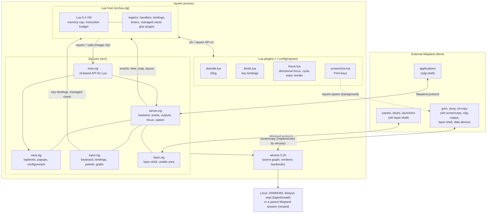

# Architecture

RayWM keeps the native core small and moves policy into Lua. The core
does what must be correct and fast: Wayland protocols, input, outputs,
rendering and resource lifetimes. Plugins decide where windows go and
what keys do.

## Layers and responsibilities

| Layer | Owns | Does not do |
|---|---|---|
| **wlroots** | DRM/KMS and nested backends, renderer (GLES2 or pixman), scene graph with damage tracking, protocol implementations | policy |
| **Zig core** | protocol state machines (configure/ack, map/unmap/destroy), focus rules, pointer focus and grabs (implicit, move/resize), key binding matching, layer-shell arrangement, output hotplug, process spawning, teardown order | layout and navigation decisions |
| **Lua host** | the VM, plugin loading, ownership and deferred cleanup of registrations, error isolation, limits, timers | native pointers: Lua only ever sees integer ids |
| **Plugins** | layout (dwindle), focus navigation and the focus border (focus.lua), bindings, rules | protocol details |
| **External clients** | their own content, title bars (CSD), panels and docks | — |

## Key mechanisms

### Geometry and the configure/ack cycle

A size change is only a *request* to the client (`xdg_toplevel.configure`).
`View.place` remembers the target position with the configure serial. The
position is applied in the commit whose `ack_configure` reaches that
serial, so the new size and the new position appear in the same frame.
Interactive resizes from the left or top edge keep the opposite edge fixed
until the client has acknowledged the last resize. Lua sees the result as
`view_resized`.

### Ids instead of pointers

Every window and output gets a `u32` id that is not reused. `host.zig`
resolves the id again on every call. A stale id gives `nil, "stale"`; it
can never reach freed memory.

### Plugin ownership and deferred cleanup

Every handler, binding, timer and managed-window claim is a *registration*
tagged with its plugin. Dispatch loops never remove entries. Unloading
works like this:
1. the plugin is marked dead, which stops its callbacks immediately;
2. `sweep()` runs once no Lua code is on the stack;
3. it calls `teardown` and drops the dead plugin's registrations.

Reload is deferred the same way, then rebuilds the whole VM.

### Managed windows

`ctx.manage(id)` is a registration, so it disappears automatically with
its plugin or its window. `input.zig` asks the runtime (`rt.managed(id)`)
in one place: the start of an interactive move/resize. That covers
Super+drag and client-side title bars alike. It asks again on every
motion of an active grab, so a window that becomes managed mid-drag
stops moving.

### Pointer input and grabs

Pointer events go to exactly one owner at a time, decided in
`src/input.zig` in this order:

1. **A compositor grab** (`server.grab`): interactive move or resize,
   started by Super+left/right drag or by a client's
   `xdg_toplevel.move`/`resize` request (a client-side title bar). No
   client gets pointer events; the window follows the cursor. A Super+drag
   press is never sent to the client, so neither is its release. A
   client-side move/resize was started by a press the client saw: its
   release is passed to the seat when the grab ends, so wlroots does not
   keep counting the button as held. Managed (tiled) windows refuse both
   kinds.
2. **A wlroots grab** (`seat.pointerHasGrab()`): today only an
   `xdg_popup` grab (a menu opened with a grab). wlroots implements it
   completely and decides which of the client's surfaces get events;
   RayWM only keeps telling it which surface is under the cursor.
3. **The implicit grab of `wl_pointer`.** When a button goes down over a
   surface, that surface "owns" the pointer until the last button is
   released. This is what lets a text selection, a scrollbar or a
   slurp region continue outside the window that started it.
4. Otherwise pointer focus **follows the cursor**: the scene is
   hit-tested on each motion and the surface under the cursor gets
   `enter`, `motion` and `leave`.

**What wlroots provides, and what RayWM adds.** wlroots counts the held
buttons of the seat (`pointer_state.button_count`, including several
buttons at once) and sends the protocol events. Its *default* grab does
not implement the implicit grab: `wlr_seat_pointer_notify_enter` moves
focus wherever it is told, and forgets the held buttons when the focus
changes. Before v0.1.2, RayWM hit-tested on every motion, so a drag
leaving the window moved the focus and the release reached nobody. Now,
while `button_count > 0` and no wlroots grab is active:
- motion is not hit-tested; it goes to the focused surface, with
  coordinates computed from that surface's **current** scene position
  (`PointerNode`: the scene buffer of the focused surface, with a destroy
  listener), so they stay right if a plugin moves the window meanwhile.
  They may lie outside the surface, as the protocol allows;
- buttons pressed meanwhile go to the same surface; click-to-focus and
  Super+drag only react to the first press of an interaction;
- scene changes under the cursor (`refocusPointer`: windows mapped,
  moved, hidden, layer surfaces appearing) do not move the focus;
- after the release that brings the count to zero, the cursor position
  is hit-tested again and the surface under it gets `enter`.

RayWM keeps no button counter of its own; `button_count` is the single
source of truth.

**When the grab surface goes away.** If the surface is destroyed (the
window closes or the client crashes), wlroots clears pointer focus
without forgetting the held buttons, and the `PointerNode` listener
drops the scene node. If it is unmapped or hidden, its scene node is
disabled and the next refocus clears pointer focus the same way (with a
`leave`). Either way, no surface has the pointer until the last button
is released: no other client receives the release of a press it never
got, nor motion with a button it does not know is held. Layer surfaces
of an unplugged output are destroyed like any other surface; windows on
it are moved to a remaining output and keep the grab.

**Keyboard focus is separate.** Super+H/J/K/L may move keyboard focus
while a button is held; the pointer stays with the grab surface. The
optional pointer warp of focus.lua (`raywm.pointer_warp`) is refused
during every kind of grab and while an exclusive layer surface holds
the keyboard, so it can neither drag a window nor pull a held
interaction elsewhere. An active pointer lock or confinement also refuses
plugin warps. Constraints belong to the pointer-focused surface and only
activate while its root surface has keyboard focus. Locked pointers receive
relative motion without moving the visible cursor or sending absolute
`wl_pointer.motion`; confined motion is clipped along its segment against
the committed surface-local region, including holes. wlroots owns these
objects; RayWM drops its active borrow before deactivation, which can free
a oneshot constraint. Destroy listeners clear the borrow on client exit.

Keyboard shortcut inhibitors activate only for the keyboard-focused
surface and stop compositor bindings while active. VT switching remains
available. **Ctrl+Alt+Escape** releases pointer and shortcut captures until
keyboard focus changes, so a client cannot indefinitely trap compositor
controls. Session locking deactivates captures before input reaches lock
surfaces. `tests/captures.sh` checks these rules with real protocol clients,
including oneshot lifetime, cursor hints, region updates and client death.

**Tests.** `tests/pointer.sh` drives a virtual pointer against real
clients that log every `wl_pointer` event they receive, and checks the
exact event streams: drags across other windows, several buttons,
releases outside every surface, subsurfaces, layer surfaces, popups and
windows destroyed while a button is held, an output unplugged while a
button is held, scene changes under a held button, client-side
move/resize, Super+drag and an `xdg_popup` grab. Eleven of its thirteen
scenarios fail on v0.1.1. `tests/screenshot.sh` drags a real slurp
selection across two outputs.

### Key bindings and keyboard layouts

A key press is matched against bindings with its level-0 (unshifted)
keysym in the active layout, so `Super+Shift+1` works whatever Shift+1
produces. Bindings are written with Latin key names; when the active
layout gives a non-Latin character for the key (Cyrillic, Greek, ...),
the key's Latin keysym from another layout of the same keymap is used
instead (`us,ru` with Russian active: J still matches `Super+j`). Keys
that are not characters (Return, F1, Print) are the same in every layout.
`raywm -d` logs each press with Super, Ctrl or Alt and what it matched.

### Frame scheduling

RayWM draws only when wlroots emits `frame` for an output. That happens
when the scene has damage or a client asked for a frame callback. An idle
desktop does no rendering work and runs no Lua. Native animations request
subsequent frames only while active. Outputs without a backend DRM FD force
composition: they retain renderer DMA-BUF import/feedback but have no valid
scanout device to advertise.

### Screenshots: protocol in the core, policy in a plugin

The core only creates two wlroots globals in `Server.init`:
`wlr-screencopy-unstable-v1` and `xdg-output-unstable-v1`. wlroots
implements them completely: it copies the output's committed frame into
the client's buffer, schedules a frame when a copy is requested
(`needs_frame`), and fails a pending copy whose output is destroyed.
Both managers belong to the display and are freed with it, so the core
keeps no pointer to them.

Everything a user sees as "screenshots" is `config/plugins/screenshot.lua`:
key bindings, file names and directories, the clipboard and
notifications. It builds one command per key press and hands it to
`raywm.spawn`, which double-forks into the background, so neither Lua
nor the compositor waits for grim or slurp. File names are passed only
as single-quoted positional arguments of a fixed `sh` script.

### Popups and window geometry

wlroots' xdg scene tree places a surface so that the tree's origin is
the window geometry's top-left (excluding client-side shadows). A
view's tree is therefore positioned at the view's `(x, y)`. Popups get
a scene tree as a child of their parent's tree; that tree lives exactly
as long as the popup role, and is forgotten if wlroots destroys it
first together with the parent (a toplevel destroyed while its popup is
open). When a toplevel unmaps, its popups are hidden before the pointer
is refocused, because wlroots destroys them only after the unmap.

### Focus

Lua handlers run while a window maps. During this time,
`raywm.focused()` still returns the previous window, which is what a
tiler splits. The new window gets focus afterwards, unless a handler
chose focus explicitly; `Server.focus_requests` counts focus calls to
detect this.
- Exclusive layer surfaces (launchers, lock screens) keep the keyboard.
  A newly mapped top/overlay surface takes it only from nobody, from an
  on-demand surface, or, if it is exclusive itself, from an exclusive
  surface in the same or a lower layer. When the holder goes away, the
  remaining exclusive surface in the highest layer gets the keyboard
  back before the focused window.
- When the seat's active keyboard is unplugged, the seat switches to a
  remaining keyboard.
- Keys consumed by a binding are never reported as held to the next
  focused client.
- Focus *navigation* (which window is next, left, right) is policy and
  lives in `config/plugins/focus.lua`; the core only executes
  `raywm.view_focus`. Its directional choice is geometric and costs O(n)
  per key press; nothing runs per frame or per pointer motion.
- The focus border is drawn by focus.lua with `raywm.view_border`: four
  `wlr_scene_rect`s in the window's scene tree, below its surfaces and
  popups, following its size on commit.

### Processes and signals

SIGINT and SIGTERM are handled through the event loop (signalfd). Child
processes:
- are double-forked into a new session;
- get an empty signal mask;
- are never left as zombies.

## v0.2 native modules

| Module | Responsibility |
|---|---|
| `server.zig`, `main.zig` | backend/scene/seat ownership, ordered teardown, focus and event dispatch |
| `view.zig`, `xwayland.zig` | common xdg/X11 view state; configure/ack only for xdg, real buffer-size completion for X11; lazy XWM process and override-redirect surfaces |
| `workspace.zig`, `taskbar.zig` | native visibility/focus, hotplug recovery and idle-coalesced desktop protocol publication |
| `protocols.zig`, `constraints.zig` | protocol globals/filtering, input-backed activation grants, constrained pointer/shortcut lifecycles |
| `data.zig`, `textinput.zig` | drag validation/icons/cancellation; seat-local text/IME relay, popups and keyboard grabs |
| `output.zig`, `outputconfig.zig`, `inputconfig.zig` | native output transactions and per-device settings |
| `lock.zig`, `input.zig`, `layer.zig` | lock presentation/input exclusion, pointer/keyboard grabs, layer arrangement |
| `animation.zig`, `visual.zig` | bounded generation-handle tables; native output-frame tweens, owned snapshots and rectangles |
| `ipc.zig` | same-UID, versioned NDJSON desktop queries/actions/events with resource limits |
| `lua.zig`, `host.zig` | VM, plugin-owned registrations, protected dispatch and ID-based native API |

Xwayland associations create the same View abstraction used by Lua layout,
floating, workspaces and fullscreen. Native X11 objects remain wlroots-owned;
wrappers own listeners and scene nodes. X11 menus retain owner IDs, not
borrowed View pointers. The Xwayland shell global is exposed only to the
compositor's actual Xwayland client. No gaming compatibility is inferred.

Text-input entries are eligible only for the seat's current keyboard surface
and an enabled text input. The active IME receives surrounding state and sends
preedit/commit/delete back only while eligible. Its own virtual keyboard
bypasses its input-method grab to avoid feedback. DnD validates the real
initiating press, delegates offers/grabs to wlroots, owns the icon tree and
destroys the source to notify a rejected/cancelled drag.

Animation jobs retain a View ID or an independently owned snapshot tree.
Scene buffer locks preserve snapshots after source destruction. Output frame
callbacks update offset/opacity using monotonic time and easing, and request
more frames only while jobs remain active. Logical layout geometry stays
separate. There are no Lua frame hooks. Visual nodes are tagged and skipped
by input hit testing; attached resources retire on view unmap and all owned
registrations retire on plugin fault/reload. Locking clears snapshots and
hides every non-lock layer.

IPC shares the event loop without blocking reads/writes. Each client has
fixed input/output storage, a partial-request deadline and selected event
bits. Reentrant actions can emit events, so dead-client destruction is
swept only after the active callback returns. Native state queries expose
IDs and values, never arbitrary object access or code evaluation.

## v0.2.2: settings and updates

**raywm.conf** (`src/conf.zig`, loaded by `src/settings.zig`). One
`conf.Settings` value lives in the server; it is built from fixed-size
fields (bounded integers, colours as `#rrggbbaa`, strings of at most 256
bytes), so parsing allocates nothing and a reload cannot leak. The schema
is the struct itself: the parser, `raywm -t` and the Lua export walk its
fields at compile time, so a setting cannot exist in one place and be
missing in another. `main` loads it before `Server.init` (Xwayland reads it
there); a reload loads it again in `Runtime.leaveOuter` *before* the old Lua
state is closed, and replaces the whole value only if every layer is
valid. Core-owned settings are read where they act, at event time
(map, button press, motion, the fallback key), so no other state needs to
be refreshed. Plugin-owned settings (gaps, borders) are only exported:
`raywm.settings` is a fresh table per Lua state; the plugins remain the
only code that lays out windows or draws borders. Plugin loading stays in
`init.lua`, so there is no second list of plugins. Cost: a struct of a few hundred
bytes, one file read per start or reload, and one table per Lua state;
nothing per frame.

**raywm-update** (`src/update.zig`) is a separate short-lived program,
not part of the compositor. It links only libc and runs `curl` (HTTPS
transport and CA handling, already a pacman dependency), `vercmp` (exact
pacman version order), `tar`, `pacman` and, for Betas, the archive's own
`scripts/arch-package.sh`. Everything it reads from the network is
validated against the tag scheme before use; see
[RELEASE-WORKFLOW.md](RELEASE-WORKFLOW.md#update-metadata-raywm-releasejson-schema-1)
and [INSTALL.md](INSTALL.md#updates-raywm-update).

## Extension points and limits

The core owns protocol/resource correctness; Lua owns layout, bindings,
rules, workspace naming and optional effects policy. API v1 remains additive.
See [PLUGINS.md](PLUGINS.md), [API.md](API.md), [EFFECTS.md](EFFECTS.md)
and [IPC.md](IPC.md). Drawing supports borders and solid rectangles;
blur, shadows, rounded clipping, text/image primitives and custom shaders
are NOT IMPLEMENTED. Touch/tablet routing is not implemented. Protocol
advertisement alone does not establish device or advanced-effect support.
