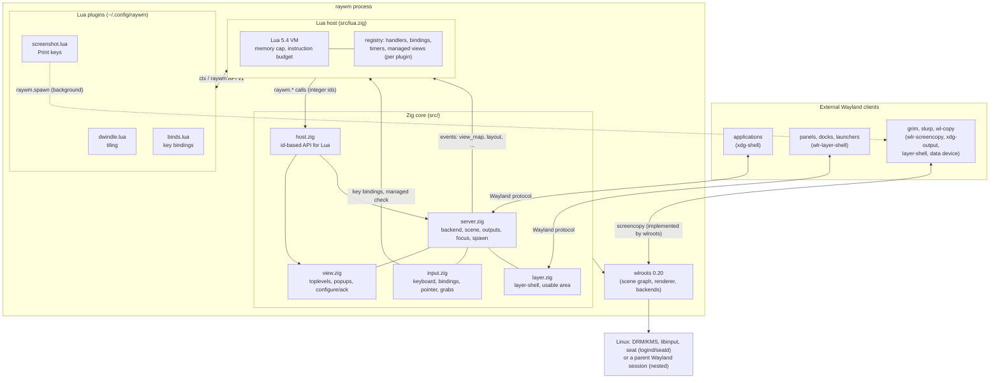

# Architecture

RayWM keeps the native core small and moves policy into Lua. The core
does what must be correct and fast: Wayland protocols, input, outputs,
rendering and resource lifetimes. Plugins decide where windows go and
what keys do.

## Layers and responsibilities

| Layer | Owns | Does not do |
|---|---|---|
| **wlroots** | DRM/KMS and nested backends, renderer (GLES2 or pixman), scene graph with damage tracking, protocol implementations | policy |
| **Zig core** | protocol state machines (configure/ack, map/unmap/destroy), focus rules, interactive grabs, layer-shell arrangement, output hotplug, process spawning, teardown order | layout decisions |
| **Lua host** | the VM, plugin loading, ownership and deferred cleanup of registrations, error isolation, limits, timers | native pointers: Lua only ever sees integer ids |
| **Plugins** | layout (dwindle), bindings, rules | protocol details |
| **External clients** | their own content, title bars (CSD), panels and docks | — |

## Key mechanisms

### Geometry and the configure/ack cycle

A size change is only a *request* to the client (`xdg_toplevel.configure`).
`View.place` remembers the target position with the configure serial. The
position is applied in the commit whose `ack_configure` reaches that
serial, so the new size and the new position appear in the same frame.
Interactive resizes from the left or top edge keep the opposite edge fixed
until the client has acknowledged the last resize. Lua sees the result as
`view_resized`.

### Ids instead of pointers

Every window and output gets a `u32` id that is not reused. `host.zig`
resolves the id again on every call. A stale id gives `nil, "stale"`; it
can never reach freed memory.

### Plugin ownership and deferred cleanup

Every handler, binding, timer and managed-window claim is a *registration*
tagged with its plugin. Dispatch loops never remove entries. Unloading
works like this:
1. the plugin is marked dead, which stops its callbacks immediately;
2. `sweep()` runs once no Lua code is on the stack;
3. it calls `teardown` and drops the dead plugin's registrations.

Reload is deferred the same way, then rebuilds the whole VM.

### Managed windows

`ctx.manage(id)` is a registration, so it disappears automatically with
its plugin or its window. `input.zig` asks the runtime (`rt.managed(id)`)
in one place: the start of an interactive move/resize. That covers
Super+drag and client-side title bars alike. It asks again on every
motion of an active grab, so a window that becomes managed mid-drag
stops moving.

### Frame scheduling

RayWM draws only when wlroots emits `frame` for an output. That happens
when the scene has damage or a client asked for a frame callback. An idle
desktop does no rendering work and runs no Lua.

### Screenshots: protocol in the core, policy in a plugin

The core only creates two wlroots globals in `Server.init`:
`wlr-screencopy-unstable-v1` and `xdg-output-unstable-v1`. wlroots
implements them completely: it copies the output's committed frame into
the client's buffer, schedules a frame when a copy is requested
(`needs_frame`), and fails a pending copy whose output is destroyed.
Both managers belong to the display and are freed with it, so the core
keeps no pointer to them.

Everything a user sees as "screenshots" is `config/plugins/screenshot.lua`:
key bindings, file names and directories, the clipboard and
notifications. It builds one command per key press and hands it to
`raywm.spawn`, which double-forks into the background, so neither Lua
nor the compositor waits for grim or slurp. File names are passed only
as single-quoted positional arguments of a fixed `sh` script.

### Popups and window geometry

wlroots' xdg scene tree places a surface so that the tree's origin is
the window geometry's top-left (excluding client-side shadows). A
view's tree is therefore positioned at the view's `(x, y)`. Popups get
a scene tree as a child of their parent's tree; that tree lives exactly
as long as the popup role, and is forgotten if wlroots destroys it
first together with the parent (a toplevel destroyed while its popup is
open). When a toplevel unmaps, its popups are hidden before the pointer
is refocused, because wlroots destroys them only after the unmap.

### Focus

Lua handlers run while a window maps. During this time,
`raywm.focused()` still returns the previous window, which is what a
tiler splits. The new window gets focus afterwards, unless a handler
chose focus explicitly; `Server.focus_requests` counts focus calls to
detect this.
- Exclusive layer surfaces (launchers, lock screens) keep the keyboard.
  A newly mapped top/overlay surface takes it only from nobody, from an
  on-demand surface, or, if it is exclusive itself, from an exclusive
  surface in the same or a lower layer. When the holder goes away, the
  remaining exclusive surface in the highest layer gets the keyboard
  back before the focused window.
- When the seat's active keyboard is unplugged, the seat switches to a
  remaining keyboard.
- Keys consumed by a binding are never reported as held to the next
  focused client.

### Processes and signals

SIGINT and SIGTERM are handled through the event loop (signalfd). Child
processes:
- are double-forked into a new session;
- get an empty signal mask;
- are never left as zombies.

## Source map

| File | Lines (v0.1.1) | Content |
|---|---|---|
| `src/main.zig` | 77 | arguments, signals, config path, startup and teardown order |
| `src/server.zig` | 425 | `Server`, `Output`, focus, spawn, layout changes, screencopy/xdg-output globals |
| `src/view.zig` | 311 | `View` (xdg toplevel), `Popup` |
| `src/input.zig` | 367 | keyboards, bindings, pointer, grabs |
| `src/layer.zig` | 203 | layer-shell surfaces, arrangement, keyboard rule |
| `src/host.zig` | 126 | Lua-facing API implementation |
| `src/lua.zig` | 740 | Lua runtime |

Total: 2249 physical lines (`wc -l src/*.zig`), comments included; v0.1.0
had 2165 (v0.1.1: +106 / −22). Tests, documentation, CI and scripts are
not counted.

## Extension points and their limits

Plugins can observe window, focus, title, resize and output events, and
control geometry, visibility, opacity, stacking, focus, closing,
bindings, timers and process spawning.

Plugins cannot:
- draw anything;
- run code per frame;
- see client contents (screenshots are taken by external programs);
- change protocol behaviour.

Per-frame hooks and decorations are planned for v0.2. Effects such as
blur or rounded corners would need a custom renderer, and are out of
scope for the wlroots scene renderer used here.
