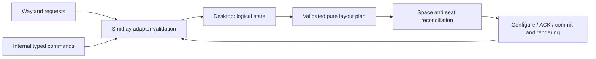

# Rust Stage 5A: workspace and configuration architecture

This is the experimental `feature/rust-smithay` implementation on Smithay
`=0.7.0`, with Linux x86_64 nested/software qualification. It extends the
existing `Desktop` and preserves the Zig desktop. It does not introduce Lua,
IPC, a user configuration format, a tiling algorithm or a native backend.
[Qualification and evidence](measurements/v0.3.0/stage5a/qualification.md).

## Ownership and integration

| Module | Responsibility |
|---|---|
| `raywm-core/src/windows.rs` | Stable window IDs, lifecycle, committed geometry, stacking, focus and interactive geometry state |
| `raywm-core/src/policy.rs` | Private `windows` implementation module: workspace/output transitions, transient families, layout snapshots and command validation |
| `raywm-core/src/workspaces.rs` | Workspace IDs, workspace records and output records |
| `raywm-core/src/layout.rs` | Framework-free layout input, placement plan, validation and floating engine |
| `raywm-core/src/config.rs` | User-policy snapshot types, explicit defaults and validation |
| `raywm-core/src/commands.rs` | Typed requests, synchronous result events, protocol effects and errors |
| `raywm-compositor/src/policy.rs` | Internal command entry point, protocol-grab/hint checks, close effects, scene/focus/popup reconciliation |
| `raywm-compositor/src/shell.rs` | Window ID ↔ Smithay Window/surface bindings, configure flights and ACK/commit gate |
| `raywm-compositor/src/nested.rs` | Single real nested output, mode observation into core, rendering and frame callbacks |

`Desktop` owns the only mutable logical registry. Its fields are private;
queries return shared references. There is no mutable global, new mutex,
new dependency or unsafe code. `View` binds a stable ID to a Smithay `Window`,
XDG error resource and handshake metadata. Protocol serials, buffers,
subsurfaces, popup trees and seat grabs remain Smithay responsibilities.
The existing vector of resource bindings is not another policy registry.

`Space` is a projection: reconciliation removes hidden windows, calculates
validated placements, then maps visible windows in the core's global order.
It never supplies membership, desired positions or logical focus. Core sizes
represent committed geometry; a suggested size and configure flight are
separate pending state. Rendering still uses actual Smithay surface trees.

## Window invariants

- Checked nonzero u32 window IDs are never recycled. Exhaustion returns an
  error; the adapter requests that the new client close its toplevel.
- Created, mapped and unmapped are explicit states. Destroyed means removal
  from the registry and adapter, never a retained tombstone with live handles.
- Each role belongs to exactly one existing workspace, including before map
  and while unmapped. Null-buffer unmap preserves its ID, workspace and
  floating geometry; remap performs a new initial configure/ACK handshake.
- The global stack contains each mapped window exactly once, including
  hidden workspaces. Unmap/destroy removes it and cancels its operation.
- At most one window is logically focused. Only a mapped, focus-eligible
  window in a visible workspace can receive focus. Invalid focus leaves the
  previous focus intact; unmap/destroy falls back to the topmost eligible one.
- Transient parents are checked IDs, without cycles. A mapped parent and its
  descendants share membership and are raised as a family, parents before
  children. Focusing one root does not implement modal-dialog policy.
  Parent changes adopt its workspace; a family transfer moves the root and
  all descendants. Destroy/unmap clears direct child links; an unmapped parent
  is treated as no parent. Unmapping a child clears its own parent link.
- XDG popups are never managed windows. They stay in PopupManager with a
  checked root ID. Hiding a root dismisses its current popup tree. Root
  unmap/destroy retains the existing dismissal/grab cleanup paths.
- Reparenting that changes membership cancels affected geometry operations.
  Reconciliation clears cancelled adapter flights and the Resizing state.

## Workspaces and outputs

`WorkspaceId` uses a checked monotonic u64 counter, separate from window IDs.
The default desktop has workspace 1. `Desktop::workspace_windows` derives its
list from window membership; there is no second mutable member list.

Each workspace has one optional `OutputId` binding and a layout selection.
Each registered output has logical bounds and at most one active bound
workspace. Several workspaces may bind to one output. Each output may show a
different workspace simultaneously. `active_workspace()` is the selected
workspace for new roles, not a replacement for per-output active state.
Explicit activation chooses its topmost eligible window; focusing a visible
window on another output selects that window's workspace for future roles.

| Operation | Rule |
|---|---|
| Create | Create an empty, detached floating workspace; never auto-delete an empty workspace |
| Activate | Switch the workspace on its bound output and select/focus it; when outputs exist, detached activation fails with `UnknownOutput` |
| Transfer | Validate both IDs first; move the complete transient family, preserve geometry/lifecycle, repair focus |
| Remove | Reject the last workspace, a stale ID, or identical fallback; move all mapped/unmapped members to an explicit existing fallback |
| Bind/reassign | Reject unknown outputs; bind or detach without moving windows; repair active selections on both affected outputs |
| Active selection repair | If a removed/rebound workspace invalidates an output's active selection, choose its first remaining bound workspace in ID order, or none |
| New output | Adopt the selected workspace if it is detached; otherwise begin empty until explicitly bound |
| Output resize | Validate positive i32-sized logical bounds and retain active workspace/bindings |
| Output removal | Cancel affected operations, detach all its workspaces, preserve windows and geometry, repair focus; do not silently relocate to another output |
| No outputs | Keep the selected detached workspace logically visible for headless policy/lifecycle tests; without a real output no frames/presentation are fabricated |

Structural commands return `Busy` during interactive operations or pending
resizes. Physical output removal and protocol parent observations are lifecycle
facts and can cancel operations. The production backend currently observes
only one nested output and its resize. Multi-output/hotplug model transitions
are core-tested; physical hotplug, seat recovery and output relocation need a
later backend adapter.

## Layout contracts

`LayoutEngine::arrange(LayoutInput)` is pure. Input contains optional output
bounds and mapped visible `LayoutWindow` snapshots in stack order. Output is a
`LayoutPlan` of desired placements. Validation rejects duplicate/missing/foreign
window IDs and dimensions outside positive i32 surface geometry. The adapter
alone handles configure/commit and applies placement positions.

`LayoutKind::Floating` keeps committed geometry, including negative positions
from dragging. Initial placement retains the old default cascade. The pure
contract also represents `Presentation::Fullscreen` and `Maximized` using
output bounds; without bounds it returns `MissingOutput`. These calculations
do not claim protocol support or change a managed window's state.

`LayoutKind::Tiling` is a reserved selection with an explicit `Unsupported`
result. There is no fallback algorithm pretending to tile. Floating/tiled
participation and normal/maximized/fullscreen presentation are typed window
metadata, currently initialized to floating/normal and not mutable through a
successful stateful-mode command. Stage 5B must add restore geometry, layout
participation policy and stateful configure/ACK application together.

## Configuration

`HeadlessConfig` remains bootstrap/socket configuration. `Configuration` is an
owned, typed user-policy snapshot; runtime workspaces/windows and protocol
objects are separate. No parser or Lua runtime is loaded. Existing `ray.conf`
and Lua API v1 files are untouched.

| Floating setting | Default | Valid range |
|---|---|---|
| `cascade_step` | 48 pixels | 0–4096 |
| `cascade_slots` | 5 | 1–256 |
| `secondary_percent` | 60 | 1–100 |

`ApplyConfiguration` validates the complete candidate before replacement and
returns a typed error without changing the old snapshot on failure. Busy
geometry operations defer replacement. Placement changes affect future
initial placements only; existing floating geometry is preserved. There are
no setting names exposed through Lua or IPC at this stage. A later Lua host
can build a candidate snapshot and submit it through this boundary without
owning compositor state. Parsing/layering/reload remain Stage 5C work.

## Commands and events

`Desktop::execute(Command)` validates core semantics and returns `CommandResult`
with synchronous events and explicit effects. `State::execute_command` is the
integration entry point for future Lua/IPC callers. It additionally rejects
commands that would interfere with implicit/explicit pointer, keyboard, popup
or DnD grabs, and checks protocol size hints for direct resize requests.
`CreateWorkspace` and a close request remain safe during grabs.

| Stage 5A supported commands | Result |
|---|---|
| FocusWindow | Validate visibility, set exclusive focus and raise family |
| CloseWindow | Return/apply a client close request; retain the window until real destruction |
| MoveWindow | Update floating position and project it to Space |
| ResizeWindow | Queue desired size through the existing one-flight configure path; committed size waits for ACK plus surface commit |
| Create/Remove/ActivateWorkspace | Apply the workspace rules above |
| MoveWindowToWorkspace / BindWorkspace | Validate membership/output changes and reconcile visibility/focus/popups |
| SetLayout(Floating) | Select the supported floating layout |
| ApplyConfiguration | Validate and atomically replace the snapshot |

`SetLayout(Tiling)`, `ToggleFloating` and `SetPresentation` are contracts that
return `Unsupported`, without mutation. Fullscreen/maximized protocol state,
tiling calculations, user bindings/workspace UX, Lua invocation, serialized IPC,
subscriptions and bindings remain deferred. No event bus is introduced.

Result events describe accepted command transitions: workspace creation/removal/
activation, transfers, binding/layout selection, movement/resize requests,
configuration application and focus changes. They are not a complete Wayland
lifecycle subscription stream; protocol-created/destroyed windows still enter
through the existing shell hooks. A later host must observe those hooks and
re-resolve IDs before callbacks; no callback reentrancy is added here.

## Verification and Stage 5B prerequisites

The [qualification record](measurements/v0.3.0/stage5a/qualification.md) lists
actual commands, runtime results and retained logs. The core sequence tests
check registry/workspace/focus/stack invariants after 600 deterministic
operations. In-process integration uses real socket/shm/XDG requests and
inspects both core and Space, including unacknowledged commits and popup_done.
Existing nested/software scenarios still check submitted pixels and real input.

Stage 5B can use workspace queries, `Desktop::layout_plan`, `LayoutEngine`,
`LayoutPlan::validate` and `State::execute_command`. Before enabling tiling or
fullscreen/maximize, implement a deterministic algorithm, restore/floating
geometry policy, mode capability advertisement, configure-flight scheduling
and stateful ACK/commit integration. Add workspace user bindings and graphical
switching tests. Multi-output core tests do not qualify physical backend
hotplug. Stage 5B has not been started by this change.
