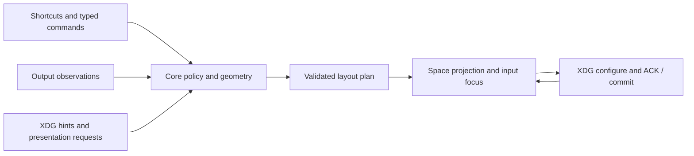

# RayWM Rust Stage 5B

Stage 5B adds hybrid window management to the experimental Linux Smithay
compositor. Winit opens one nested output. Each of the nine initial workspaces
starts in Master-Stack. `--floating` starts them in Floating mode. Headless
keeps the protocol-only lifecycle. [Qualification and evidence](measurements/v0.3.0/stage5b/qualification.md).

## Architecture

`raywm-core` owns role lifecycle, membership, focus, stacking, saved floating
geometry, and layout settings. The tiling order starts in window creation
order and changes through `ReorderWindow`. Raising a window leaves the tiling
order intact. The Smithay adapter binds IDs to resources and owns configure
flights. It validates each pure `LayoutPlan` before updating `Space` positions
or scheduling sizes. It reconciles on policy, lifecycle, geometry, size-hint
and output events. Rendering uses the existing scene and actual committed
surface trees.

## Layout and geometry

| Layout | Placement |
|---|---|
| Master-Stack | The master area uses 55% of the width after the central gap by default. Masters divide the left column vertically. The remaining windows divide the right column vertically. One window fills the inset area. |
| Columns | Split the horizontal axis into equal integer shares. Earlier tiles get the remainder pixels. |
| Monocle | Show the most recently raised tile and its transient family. Other tiles retain their roles and can become active through keyboard focus cycling. |
| Floating | Use saved floating rectangles and the existing initial placement and interactive move/resize behavior. |

The default gaps are 8 logical pixels around and between tiles. The master
ratio is typed and accepts 10–90%. The positive master count defaults to one.
`ApplyConfiguration`, `SetGaps` and `SetMasterRatio` are internal commands.
Gap settings accept 0–4096 logical pixels.

Layouts work in global logical coordinates. Tiling and maximize use output
usable bounds, while fullscreen uses the full output. The Winit backend has
no reserved panels. The pure API accepts a usable sub-rectangle for adapters
that know about reservations. Tiled splits honor feasible minimums on their
partition axes and reduce inner gaps as needed. Maximum hints cap each
window within its cell. A cap can leave blank space. If the minimums cannot
fit, every tile keeps a positive cell within the usable rectangle. If there
are more tiles than pixels on the split axis, surplus tiles share its final
pixel and the stacking order makes the result deterministic. For an unchanged
floating mode, XDG interactive sizing continues to apply its min/max hints.

## Window state and XDG

The base policy is automatic tiling or an explicit floating override.
Transient toplevels float with their family. Workspace Floating mode makes
the base placement floating for every window and retains individual overrides
for later layouts. Maximized and fullscreen are presentation modes.
Fullscreen takes precedence while preserving the maximize preference.
Exiting fullscreen restores maximized if it is still requested. Exiting the
last presentation mode restores the base layout.

A floating rectangle is saved in the core on first map and refreshed from
eligible floating moves and commits. Tiled, maximized and fullscreen
configures never replace it. Windows that end up entirely outside the usable
axes after relocation recover to the usable origin on those axes. Unmap and
remap keep window membership and the saved rectangle, and remap repeats the
initial XDG handshake. Destroy removes both core and Wayland bindings.

The compositor responds to XDG maximize/unmaximize and fullscreen/unfullscreen
requests. Fullscreen uses the window's workspace output. An optional client
output hint is advisory. Winit advertises Maximize and Fullscreen.
A managed configure carries the requested size and presentation or tile
flags. A buffer commit updates core committed geometry only when associated
with an eligible ACK. Changes within a mode coalesce while waiting for the
current ACK and commit. A new mode or explicit protocol request can supersede
the outstanding configure. Repeated old buffers and ACK-only messages leave
the committed size intact. Resize anchoring still uses committed size. The
renderer and pointer hit test clip managed toplevel trees to their cells
while a client holds an older or oversized buffer. Smaller fullscreen
buffers are centered in the full output. Popup trees may extend beyond
the cell.

## Workspace and output policy

Each window belongs to one workspace. Each output can show one workspace.
Workspaces remember the exact last focused window and fall back to a valid
visible member when it disappears. The pointer and keyboard follow the
projected scene. Focus cycling follows stable workspace and window order
across active outputs. Monocle can select its hidden sibling and make it
visible in the same transaction. Fullscreen projects only that window's
transient family on its output. In other modes, floating families stack above
tiled and maximized windows. The selected tiled family can rise above a
maximized sibling so it remains visible when focused.

Workspace transfers include mapped and unmapped transient family members.
XDG popups remain part of their parent surface tree. A workspace switch
dismisses popups when their parent is hidden or their grab belongs to the
workspace being left. Other commands that would redirect active popup,
pointer and DnD grabs are deferred. Unmap, destroy, and backend observations
can repair invalid grabs and focus.

Workspaces remember their preferred logical output ID. If it disappears, they
temporarily bind to the first surviving output by ID, which retains its
active workspace if possible. Disconnected workspaces stay managed and
hidden when no output is live. A returning output reclaims its workspaces.
Winit publishes one physical nested output. Two output identities, distinct
origins, transfer, fallback, reappearance, and focus are qualified in core and
real-wire integration with Smithay `Space`.

## Keyboard controls

| Binding | Action |
|---|---|
| Super + 1…9 | Activate the numbered workspace |
| Super + Shift + 1…9 | Send the focused window and its transient family to that workspace |
| Super + Page Down / Page Up | Next / previous workspace on the current output |
| Super + J / K | Next / previous window |
| Super + Shift + J / K | Reorder the focused tile |
| Super + Space | Cycle Master-Stack → Columns → Monocle → Floating |
| Super + Shift + Space | Toggle the focused window's floating override |
| Super + F | Toggle fullscreen |
| Super + M | Toggle maximized |
| Click | Focus the window under the pointer and raise its family |
| Client move / resize gesture | Move or resize an eligible floating window |

## Scope and Stage 5C

The pinned Smithay 0.7.0 accepted DnD source-disconnect defect remains open.
There is no physical hotplug qualification or multi-output Winit renderer.
Native output discovery and physical hotplug require a backend adapter. Minimize
and the compositor window menu are unavailable. Client-side decoration
behavior varies with the toolkit. Workspace bindings beyond startup and
layout settings are available through typed core commands. No Lua host, config
file loader or new IPC was added.

Stage 5C can reuse the configuration snapshot, typed commands and event
results, stable IDs, validated plans, and the configure/ACK adapter.
A configuration loader still needs validation, precedence, and atomic reload.
Lua callbacks need a separately qualified lifecycle interface and restrictions
against re-entrant state mutation.
